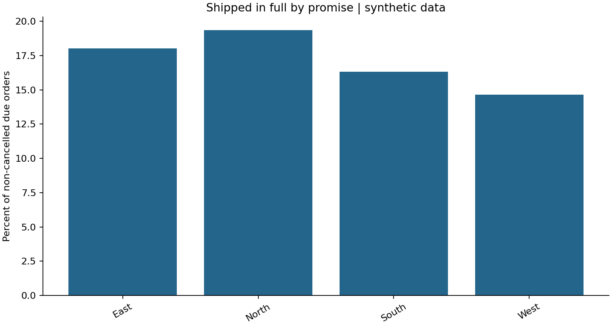

# Order Fulfilment and Backlog Exceptions

## Business question
Which orders are overdue and unshipped, and what share was shipped in full by promise?

Portfolio demonstration in Sairaj Jadhav’s analytics portfolio. All data is synthetic and is generated
deterministically; this is not TCA data or a professional implementation.

## Data
2,500 orders with split shipments, cancelled orders and future scheduled shipments.

### Data dictionary
orders: order_id, region, created_date, promised_date, ordered_units, cancelled (0/1). shipments: shipment_id, order_id, ship_date, shipped_units.

All amounts with `_paise` suffix are integer hundredths of INR to avoid storing source currency
as floating-point numbers. Dates are ISO `YYYY-MM-DD`. The fixed reporting cutoff is 21 October 2026.
Integer IDs are unique primary keys; relationship fields are enforced as foreign keys.

## Method and KPI definitions
Open units = ordered less shipped by cutoff. Overdue open = non-cancelled order with unshipped units and promise before cutoff. Service rate = orders fully shipped by promise / non-cancelled orders with promise before cutoff. Late completed orders stay in the denominator.

Read [schema.sql](schema.sql) for constraints and [analysis.sql](analysis.sql) for queries.
The SQL is written for SQLite; date functions require adaptation for PostgreSQL or SQL Server.
Inputs are generated and cleaned in [analysis.py](analysis.py), then loaded into the schema.
Where deliberate source defects are introduced, they are quarantined rather than silently repaired.

## Results
An overdue action queue, complete order reconciliation, regional service report and service chart.

Read the [computed findings](findings.md) and [validation record](validation.json).
These files are regenerated from the scripts, not manually invented.



## Reproduce
Install Python 3.10+ and run from this repository directory:

```bash
python -m pip install -r requirements.txt
python analysis.py
python tests.py
```

The script saves CSV inputs, a local SQLite database, query output CSVs, a chart and findings.
It independently computes comparable Pandas metrics and asserts agreement with SQL, checks
reconciliations and tests relevant edge cases. No network access or credentials are needed.

## Limitations and next steps
This measures shipping, not delivery OTIF. No carrier delivery times, returns, line-level promises or causal explanation for delays are available.

Before operational use: agree definitions, reconcile source-system totals, investigate rejected
records, collect missing business context, validate assumptions with users and add incremental loads.
This is a small analytical example, not a production application or a claimed business improvement.

The SQLite database is generated locally and excluded from version control. `tests.py` uses small, hand-checkable fixtures against the actual SQL.
